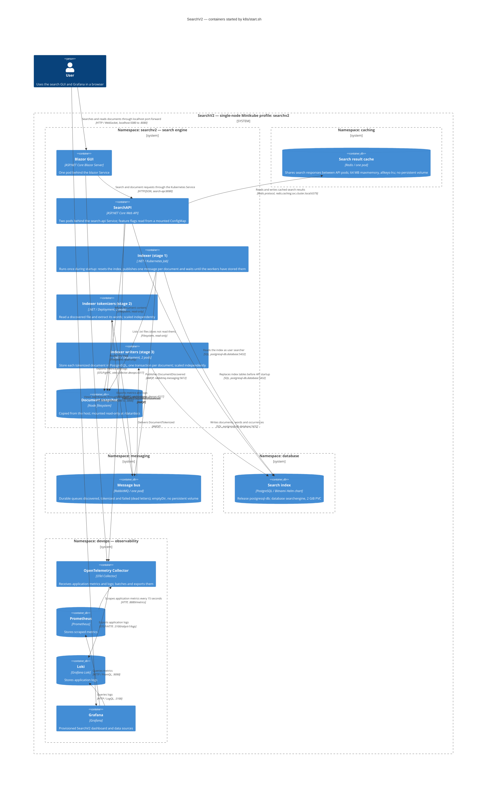
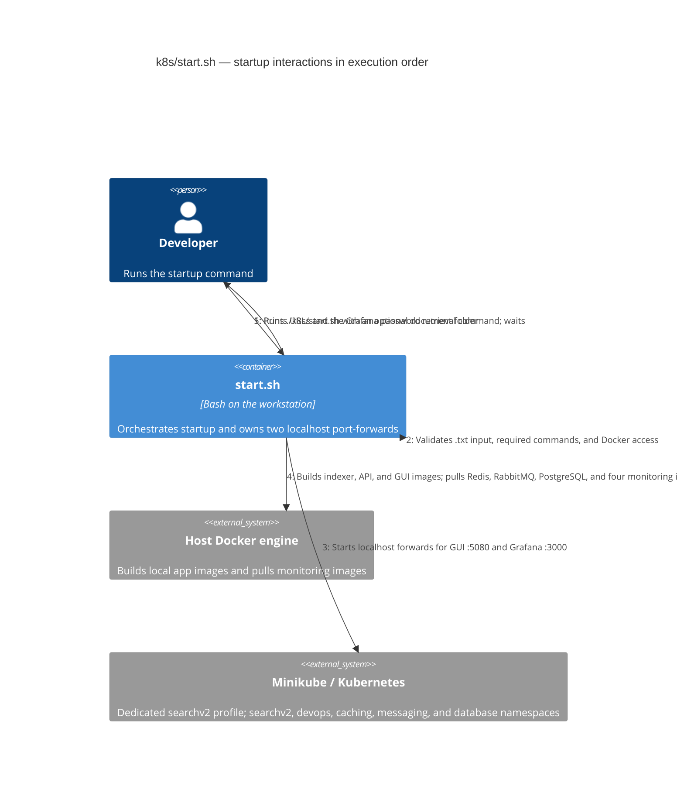

# SearchV2 startup script — C4 architecture

These views describe `k8s/start.sh`. The container view shows the deployed
applications and their communication. The dynamic view shows what the script
does to bring them up. A C4 container represents an application or data store;
the two API pods are replicas of the same container.

## C4 level 2: containers and communication

Arrows show who initiates each interaction. Prometheus pulls metrics from the
collector, while the collector pushes logs to Loki. Grafana queries the two
stores when displaying the dashboard. The port-forwards are processes on the
workstation; they are not additional deployed services.

Each boundary inside the cluster is a Kubernetes namespace, following the
teacher's C4 diagram (search engine, DevOps infrastructure, caching). Calls
inside a namespace use the short Service name (for example `search-api:8080`);
calls across namespaces use the full DNS name `<service>.<namespace>.svc.cluster.local`.
The `messaging` namespace holds RabbitMQ, the bus between the indexing stages. The `database` namespace holds the search index in PostgreSQL, installed with
the Bitnami Helm chart as release `postgresql-db` (`k8s/postgresql/custom-values.yaml`).

The technology-neutral logical view of the same system (no Kubernetes details) is in
[search-system-c4.md](search-system-c4.md).

## Containers, environment variables, volumes and networks

Source of truth: `k8s/apps.yaml`, `k8s/indexer.yaml`, `k8s/redis.yaml`,
`k8s/observability.yaml` and `k8s/postgresql/custom-values.yaml`. Passwords are never in a
manifest; they come from Kubernetes Secrets (`secretKeyRef`, or a mounted file for Redis).

### Environment variables

| Container | Variable | Value / source | Purpose |
| --- | --- | --- | --- |
| SearchAPI | `SEARCH_DB_CONNECTION` | `Host=postgresql-db.database.svc.cluster.local;Port=5432;Database=searchengine;Username=searcher;...` | Where the index lives (no password in it) |
| SearchAPI | `SEARCH_DB_PASSWORD` | Secret `postgresql-credentials`, key `password` | Database password |
| SearchAPI | `RedisConnectionString` | `redis.caching.svc.cluster.local:6379` | Cache endpoint |
| SearchAPI | `REDISPASSWORD` | Secret `redis-credentials`, key `password` | Cache password |
| SearchAPI | `OTEL_EXPORTER_OTLP_ENDPOINT` / `_PROTOCOL` / `OTEL_METRIC_EXPORT_INTERVAL` | `http://otel-collector.devops.svc.cluster.local:4317` / `grpc` / `10000` | Telemetry export (every 10 s) |
| SearchAPI | `DOTNET_USE_POLLING_FILE_WATCHER` | `true` | Lets the app notice a changed feature-flag ConfigMap without a restart |
| SearchAPI | `Logging__LogLevel__Microsoft.AspNetCore.Hosting.Diagnostics` | `Information` | Logs one line per request (shown in Loki) |
| Blazor GUI | `SearchApi__BaseUrl` | `http://search-api:8080` | Where the GUI calls the API |
| Blazor GUI | `OTEL_*` | same three as SearchAPI | Telemetry export |
| Indexer Job, writers | `SEARCH_DB_CONNECTION`, `SEARCH_DB_PASSWORD` | as for SearchAPI | Index database |
| Indexer Job, tokenizers | `INDEXER_FOLDER` | `/data/docs` | Folder of `.txt` files to index |
| Indexer Job, tokenizers, writers | `RABBITMQ_HOST`, `RABBITMQ_USER` | `rabbitmq.messaging.svc.cluster.local`, `searchv2` | Where the message bus is |
| Indexer Job, tokenizers, writers | `RABBITMQ_PASSWORD` | Secret `rabbitmq-credentials`, key `password` | Message bus password |
| RabbitMQ | `RABBITMQ_DEFAULT_USER`, `RABBITMQ_DEFAULT_PASS` | `searchv2`, Secret `rabbitmq-credentials` | Created by the image on first start |
| Grafana | `GF_SECURITY_ADMIN_PASSWORD` | Secret `grafana-admin` | Admin login |
| Grafana | `GF_USERS_ALLOW_SIGN_UP`, `GF_ANALYTICS_*` | `false` | No self sign-up, no phone-home |
| PostgreSQL | user `searcher`, database `searchengine`, `existingSecret` | Helm values | Created by the chart from the Secret |
| Redis | none | the password file is mounted from Secret `redis-credentials` at `/run/secrets/redis` and passed as `--requirepass` | Cache password |
| Collector, Prometheus, Loki | none | configuration files from ConfigMaps | |

### Volumes

| Container | Volume | Type | Survives a pod restart? |
| --- | --- | --- | --- |
| PostgreSQL | `/bitnami/postgresql` | PersistentVolumeClaim, 2 GiB | **Yes**; also survives `minikube stop` |
| SearchAPI, indexer Job, tokenizers | `/data/docs` (read-only) | `hostPath` `/data/searchv2-docs` on the Minikube node, filled by `start.sh` | Yes, but tied to the one node |
| SearchAPI | `/config` (read-only) | ConfigMap `feature-flags` | Yes (config, rebuilt from git) |
| Redis | none | none on purpose (`--save "" --appendonly no`) | **No**; cache only |
| RabbitMQ | `/var/lib/rabbitmq` | `emptyDir` | **No**; waiting messages are lost, which is acceptable because a new reindex publishes every document again |
| Prometheus, Loki, Grafana | `/prometheus`, `/loki`, `/var/lib/grafana` | `emptyDir` | **No**; history is lost when the pod is replaced (retention is 24 h anyway) |
| Collector, Prometheus, Loki, Grafana | config, data sources and dashboard | ConfigMaps (Kustomize, hash-suffixed) | Yes (rebuilt from git) |

### Networks

- Kubernetes gives every pod one IP on a flat cluster network; the containers reach each
  other through **Services** and cluster DNS, not pod IPs.
- Services: `search-api:8080`, `blazor:8080` (the only NodePort), `redis:6379`,
  `postgresql-db:5432`, `otel-collector` (4317 gRPC, 4318 HTTP, 8889 metrics, 13133 health),
  `prometheus:9090`, `loki:3100`, `grafana:3000`. All except `blazor` are ClusterIP, so they are
  reachable only inside the cluster.
- From the workstation only port-forwards are used (GUI on `localhost:5080`, Grafana on
  `localhost:3000`); the database, Redis and the API have no external entry point.
- Namespaces group the containers (`searchv2`, `devops`, `caching`, `messaging`, `database`). There are **no
  NetworkPolicies**, so a namespace is an organising boundary, not a security boundary: any pod
  could call any Service.

## Decision log

1. **Containers follow responsibility and scaling needs.** The GUI is one replica because Blazor
   Server keeps user state in a circuit; the API is stateless and runs two replicas
   (scale out, not up); indexing is a three-stage pipeline (a one-shot Job, tokenizer pods and writer pods)
   because the stages have different costs and can then be scaled separately, and the Job must
   finish before the API reads the index. Redis, PostgreSQL and the monitoring tools are separate
   containers, because they are bought, not built, and can be upgraded or replaced on their own.
2. **Only data that cannot be recomputed is persisted.** PostgreSQL has a PVC, and the documents
   are mounted read-only. Redis (cache), Prometheus, Loki and Grafana use no persistent volume or
   `emptyDir` and may disappear on a restart. The index itself is derived data that the indexer can
   rebuild, so recovery is "run the indexer". `hostPath` for the documents is a single-node
   shortcut; production would use shared or object storage.
3. **Networking is Service-based and mostly internal.** Containers find each other by Service
   name; only the GUI (and Grafana, through a port-forward) is reachable from outside. Namespaces
   separate the search engine, the cache, the database and the observability tools. The gap is the
   missing NetworkPolicies (listed as a possible hardening step).
4. **Configuration is separated from the image, and secrets from configuration.** Non-secret
   settings are environment variables or ConfigMaps; passwords are Secrets (created by
   `start.sh`, never committed). The `SearchCache` feature flag is a mounted ConfigMap file so the
   cache can be switched off without a rollback or a new image.
5. **Telemetry is pushed to one OpenTelemetry Collector**, which Prometheus scrapes and which
   forwards logs to Loki, instead of every app exposing its own metrics endpoint. Plain
   manifests were chosen over the `loki-stack` and `kube-prometheus-stack` Helm charts to keep
   the setup small and readable.

**Use of AI.** Claude Code (an AI assistant) was used to read the manifests and draft the tables
above and the first version of these decision points, and to update the diagram text for the Redis
settings and the feature flag. The details were checked against the YAML files, and the
decisions describe choices already made in the repository. *Before the exam, add here which AI
suggestions you accepted or rejected and why: you must be able to explain every element yourself.*

## C4 dynamic view: startup orchestration

The Job finishes before the script starts the API against the rebuilt index.
If indexing fails, startup stops with the API still stopped. Grafana's existing
password and Redis password are reused, and their values are not printed by the
script.

The script launches seven long-running Deployments:
Blazor, SearchAPI, Redis, the collector, Prometheus, Loki, and Grafana. With two
API replicas, these Deployments normally run eight pods in total. The Helm
release adds the PostgreSQL StatefulSet pod `postgresql-db-0`. RabbitMQ adds one pod. The
indexing pipeline adds two tokenizer pods, two writer pods and one temporary Job pod. Kubernetes also runs its own cluster infrastructure.
LoadBalancer and ConsoleSearch are excluded.

Ctrl+C terminates the script's two port-forwards and removes its local temporary
files. The cluster and deployed workloads remain running. Each new invocation
refreshes the document snapshot and rebuilds the index, creating a search
maintenance window. Monitoring history uses temporary pod storage.
