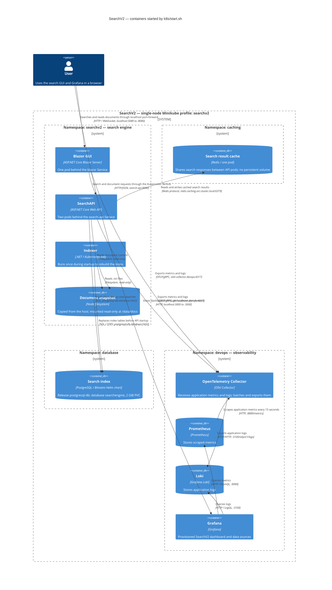
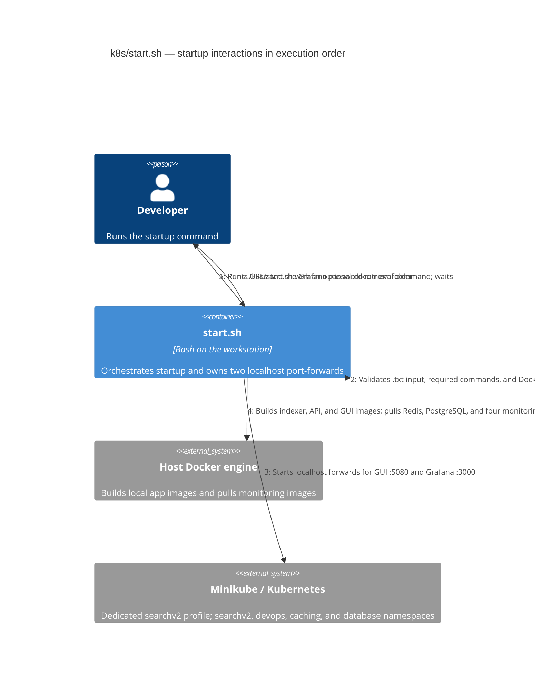

# SearchV2 startup script — C4 architecture

These views describe `k8s/start.sh`. The container view shows the deployed
applications and their communication. The dynamic view shows what the script
does to bring them up. A C4 container represents an application or data store;
the two API pods are replicas of the same container.

## C4 level 2: containers and communication

Arrows show who initiates each interaction. Prometheus pulls metrics from the
collector, while the collector pushes logs to Loki. Grafana queries the two
stores when displaying the dashboard. The port-forwards are processes on the
workstation; they are not additional deployed services.

Each boundary inside the cluster is a Kubernetes namespace, following the
teacher's C4 diagram (search engine, DevOps infrastructure, caching). Calls
inside a namespace use the short Service name (for example `search-api:8080`);
calls across namespaces use the full DNS name `<service>.<namespace>.svc.cluster.local`.
The `database` namespace holds the search index in PostgreSQL, installed with
the Bitnami Helm chart as release `postgresql-db` (`k8s/postgresql/custom-values.yaml`).

## C4 dynamic view: startup orchestration

The Job finishes before the script starts the API against the rebuilt index.
If indexing fails, startup stops with the API still stopped. Grafana's existing
password and Redis password are reused, and their values are not printed by the
script.

The script launches seven long-running Deployments:
Blazor, SearchAPI, Redis, the collector, Prometheus, Loki, and Grafana. With two
API replicas, these Deployments normally run eight pods in total. The Helm
release adds the PostgreSQL StatefulSet pod `postgresql-db-0`. The indexer adds
one temporary Job pod. Kubernetes also runs its own cluster infrastructure.
LoadBalancer and ConsoleSearch are excluded.

Ctrl+C terminates the script's two port-forwards and removes its local temporary
files. The cluster and deployed workloads remain running. Each new invocation
refreshes the document snapshot and rebuilds the index, creating a search
maintenance window. Monitoring history uses temporary pod storage.
