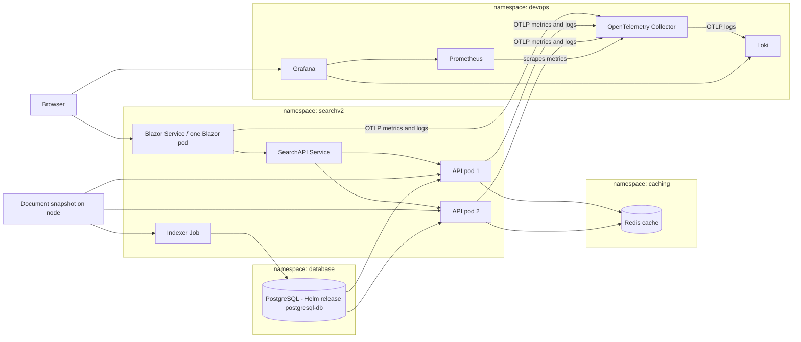

# SearchV2 on Kubernetes (Minikube)

This follows the neighbouring `MK-TEST` project: local Docker images loaded into
Minikube, plain Deployments and Services, two API replicas, and rolling updates.
It runs SearchAPI, the Blazor GUI, and an indexer Job. The LoadBalancer and
ConsoleSearch projects are excluded from both image builds and deployments.

## Start with one command

With Docker running and the requirements below installed, run from the workspace:

```sh
./k8s/start.sh
```

It uses `../seData/medium` by default. To use another document folder:

```sh
./k8s/start.sh /path/to/documents
```

The script starts the apps and the requested observability services, rebuilds
the images, and refreshes the document snapshot and index on each run. Existing
API replicas are stopped during indexing. The Grafana password is reused.
The Redis password is also reused.
If indexing fails, the script stops and leaves the API stopped for inspection.

Keep the terminal open, then open the GUI at <http://localhost:5080> and Grafana
at <http://localhost:3000/d/searchv2>. The script prints the password retrieval
command. Close existing forwards on ports 5080 and 3000 before running it.
Ctrl+C closes its forwards; stop the cluster with `minikube stop -p searchv2`.

The script's startup order and failure handling can be checked without running
a cluster using `python3 k8s/test-start.py`.

The following sections explain the architecture and equivalent manual steps.

## Architecture

See the [C4 container and startup interaction diagrams](../c4reference/kubernetes-startup-c4.md)
for the services, communication paths, and `start.sh` execution order.
How the database could be scaled (read replicas and z-axis sharding) is described in
[DATABASE-SCALING.md](DATABASE-SCALING.md).



The cluster is split into one namespace per software system, following the
teacher's C4 diagram (`k8s/namespaces.yaml`):

| Namespace | Workloads |
| --- | --- |
| `searchv2` | Blazor, SearchAPI, indexer Job |
| `devops` | OpenTelemetry Collector, Prometheus, Loki, Grafana and their ConfigMaps |
| `caching` | Redis |
| `database` | PostgreSQL from the Bitnami Helm chart (release `postgresql-db`), holding the search index |

Calls inside a namespace use the short Service name (`search-api:8080`,
`prometheus:9090`). Calls across namespaces use the full DNS name:
`otel-collector.devops.svc.cluster.local:4317` and
`redis.caching.svc.cluster.local:6379`, and
`postgresql-db.database.svc.cluster.local:5432`. Secrets are namespace-scoped, so the
Redis password exists in both `caching` and `searchv2`, and the `searcher` password
(`postgresql-credentials`) in both `database` and `searchv2`.

* The Kubernetes `search-api` Service routes connections to ready API pods.
  There is no application load balancer or redirect. HTTP connection reuse can
  keep several requests on one replica; distribution need not alternate.
  `X-Served-By` identifies the API pod that handled a request.
* Blazor runs server-side and calls `http://search-api:8080` through cluster DNS.
  It has one replica because interactive server circuits live in that process.
* The indexer is a manually triggered, single-run Job. It drops and recreates
  the `document`, `word` and `occ` tables in the PostgreSQL database
  `searchengine` as user `searcher`. Both API replicas read the same tables over
  the network with pooled connections. The indexer and API see the source
  documents at the identical `/data/docs` path, because file paths are stored in
  the index. The document snapshot is mounted read-only into the pods.
* Only the indexer changes the index tables. Reindex with API replicas stopped.
* Both API replicas share Redis search results (cache-aside, one-minute sliding TTL
  with a five-minute absolute limit; Redis evicts with `allkeys-lru` above 64 MB; see
  [CACHING.md](CACHING.md)). `start.sh` generates a Redis password in a Kubernetes Secret,
  reuses it on later starts, and restarts Redis after indexing to clear old
  search results. Redis is one pod with no persistent volume or replica; during a Redis
  outage the API answers from PostgreSQL (slower, no errors) until it returns.
* API and Blazor use the OpenTelemetry .NET SDK to export built-in ASP.NET Core,
  HTTP client, and runtime metrics plus `ILogger` logs over OTLP/gRPC. Export is
  enabled when `OTEL_EXPORTER_OTLP_ENDPOINT` is set. The collector batches metrics
  and exposes them at `:8889/metrics`; Prometheus scrapes every 15 seconds.
  Logs go from the collector to Loki's native OTLP HTTP endpoint.
* Grafana starts with Prometheus and Loki data sources and the **SearchV2**
  dashboard already provisioned, showing request rate, latency, errors, process
  memory per pod, collector availability, and logs. Unlike MK-TEST's
  Loki/Promtail Helm values, these manifests use one collector for application
  telemetry. They do not
  scrape node/container stdout: inspect the indexer and infrastructure with
  `kubectl logs`. No trace backend is included.

The .NET apps keep their existing application/core/infrastructure layers.
Telemetry is wired in `Program.cs`; Kubernetes supplies addresses and file paths.
`/healthz` checks that the web process responds, not database integrity. The
startup sequence below waits for the indexer before deploying the web apps.

## Requirements

Install Docker, Minikube, kubectl, OpenSSL, and Helm; Docker must be running and your
user must be allowed to use it. Internet access is needed for base images,
NuGet packages, Redis, PostgreSQL, the monitoring images, and the Bitnami chart repository.

Use a single-node Docker-driver Minikube cluster with about 6 GiB RAM and four
CPUs available. Run all commands from the **searchv2 workspace root**, with the
three app folders and `search-utilities` present. The Kubernetes Dockerfile
builds the local shared library, so it does not fetch another checkout from GitHub.

## 1. Start a separate Minikube profile and copy the documents

The `searchv2` profile keeps this experiment separate from MK-TEST's default
`minikube` profile. Use its context explicitly in every kubectl command.

```sh
minikube start -p searchv2 --driver=docker --nodes=1 --cpus=4 --memory=6144 --keep-context
```

Copy a snapshot of your `.txt` document folder into the dedicated node:

```sh
DOCS_DIR="$(realpath ../seData/medium)"
test -d "$DOCS_DIR"
umask 077
tar -C "$DOCS_DIR" -czf /tmp/searchv2-docs.tar.gz .
minikube cp -p searchv2 /tmp/searchv2-docs.tar.gz /tmp/searchv2-docs.tar.gz
minikube ssh -p searchv2 -- 'sudo mkdir -p /data/searchv2-docs && sudo tar -xzf /tmp/searchv2-docs.tar.gz -C /data/searchv2-docs && sudo rm /tmp/searchv2-docs.tar.gz'
rm /tmp/searchv2-docs.tar.gz
minikube ssh -p searchv2 -- 'find /data/searchv2-docs -type f -name "*.txt" | wc -l'
```

Replace `../seData/medium` with your document folder as needed. Confirm the
printed `.txt` count is positive before proceeding. Kubernetes `hostPath`
refers to the Minikube node, not your workstation. Copying the snapshot avoids
a long-running `minikube mount` process and host firewall issues. Host edits
are not automatically reflected in this snapshot. It survives cluster stops,
but deleting the profile removes it.

## 2. Build and load the three application images

```sh
docker build -f k8s/Dockerfile --target indexer -t searchv2-indexer:1.0.1 .
docker build -f k8s/Dockerfile --target search-api -t searchv2-search-api:1.0.1 .
docker build -f k8s/Dockerfile --target blazor -t searchv2-blazor:1.0.1 .
docker save searchv2-indexer:1.0.1 | minikube image load -p searchv2 -
docker save searchv2-search-api:1.0.1 | minikube image load -p searchv2 -
docker save searchv2-blazor:1.0.1 | minikube image load -p searchv2 -
```

The app and Redis manifests use `imagePullPolicy: Never`, just like MK-TEST. Redis
and monitoring images use explicit public tags and are loaded by `start.sh`.
The application images are transferred directly from Docker as archive streams
so rebuilding an existing tag does not accidentally reload an older
Minikube-cached image.

Pull and load Redis and the monitoring images from the host:

```sh
docker pull redis:7-alpine
docker pull bitnami/postgresql:latest
docker pull otel/opentelemetry-collector-contrib:0.123.0
docker pull prom/prometheus:v3.4.1
docker pull grafana/loki:3.5.1
docker pull grafana/grafana:12.0.2
minikube image load -p searchv2 redis:7-alpine
minikube image load -p searchv2 bitnami/postgresql:latest
minikube image load -p searchv2 otel/opentelemetry-collector-contrib:0.123.0
minikube image load -p searchv2 prom/prometheus:v3.4.1
minikube image load -p searchv2 grafana/loki:3.5.1
minikube image load -p searchv2 grafana/grafana:12.0.2
```

## 3. Create Redis, PostgreSQL, and observability

```sh
# Namespaces: searchv2 (search engine), devops (observability), caching (Redis), database (PostgreSQL).
kubectl --context searchv2 apply -f k8s/namespaces.yaml

# Generate a local Grafana password without committing credentials.
umask 077
openssl rand -hex 24 | tr -d '\n' > /tmp/searchv2-grafana-password
kubectl --context searchv2 -n devops create secret generic grafana-admin \
  --from-file=password=/tmp/searchv2-grafana-password

# Secrets are namespace-scoped: Redis and search-api each need a copy of the same password.
openssl rand -hex 24 | tr -d '\n' > /tmp/searchv2-redis-password
for namespace in caching searchv2; do
  kubectl --context searchv2 -n "$namespace" create secret generic redis-credentials \
    --from-file=password=/tmp/searchv2-redis-password
done
kubectl --context searchv2 apply -f k8s/redis.yaml
kubectl --context searchv2 -n caching rollout status deployment/redis --timeout=300s

# PostgreSQL (Guide M11.02): passwords live in a Secret, not in custom-values.yaml.
openssl rand -hex 24 | tr -d '\n' > /tmp/searchv2-postgres-password
openssl rand -hex 24 | tr -d '\n' > /tmp/searchv2-searcher-password
kubectl --context searchv2 -n database create secret generic postgresql-credentials \
  --from-file=postgres-password=/tmp/searchv2-postgres-password \
  --from-file=password=/tmp/searchv2-searcher-password
# The indexer and search-api (searchv2) log in as searcher and need a copy of its password.
kubectl --context searchv2 -n searchv2 create secret generic postgresql-credentials \
  --from-file=password=/tmp/searchv2-searcher-password
helm repo add bitnami https://charts.bitnami.com/bitnami --force-update
helm --kube-context searchv2 upgrade --install postgresql-db bitnami/postgresql --version 18.12.17 \
  --namespace database --values k8s/postgresql/custom-values.yaml --wait --timeout 5m
kubectl --context searchv2 get pods,services --namespace database

kubectl --context searchv2 apply -k k8s
kubectl --context searchv2 -n devops rollout status deployment/otel-collector --timeout=300s
kubectl --context searchv2 -n devops rollout status deployment/prometheus --timeout=300s
kubectl --context searchv2 -n devops rollout status deployment/loki --timeout=300s
kubectl --context searchv2 -n devops rollout status deployment/grafana --timeout=300s
```

Create each secret only on the first startup. On later startups reuse it; do not
regenerate a password file unless you intend to change credentials. After
logging in, remove the temporary files. Redis, PostgreSQL, and monitoring Services are
ClusterIP; access Grafana through a localhost port-forward, shown below.

PostgreSQL runs as the StatefulSet pod `postgresql-db-0` with a 2 GiB PVC
(`data-postgresql-db-0`). `k8s/postgresql/custom-values.yaml` creates the
user `searcher` owning the database `searchengine`; the superuser is `postgres`.
Inside the cluster, connect to `postgresql-db.database.svc.cluster.local:5432`.
The chart only reads the passwords on first initialization; changing the Secret
later does not change the database passwords while the PVC exists.
From the workstation (testing only), forward the port and connect with e.g.
DBeaver, pgAdmin or psql to `localhost:5432`, database `searchengine`, user `searcher`:

```sh
kubectl --context searchv2 port-forward --namespace database svc/postgresql-db 5432:5432
kubectl --context searchv2 -n database get secret postgresql-credentials \
  -o jsonpath='{.data.password}' | base64 --decode; echo
```

Use another local port such as `5433:5432` if a local PostgreSQL already uses 5432
(otherwise the forward fails and clients reach the local server instead).

`kubectl apply -k k8s` deploys only observability. Redis, PostgreSQL, indexing, and web apps
are applied separately so the initialization order is explicit.

## 4. Build the index, then deploy the web apps

Do this initial indexing step once. For subsequent reindexing use the procedure
below, which first stops the API.

```sh
kubectl --context searchv2 apply -f k8s/indexer.yaml
kubectl --context searchv2 -n searchv2 wait --for=condition=complete job/indexer --timeout=1800s
kubectl --context searchv2 -n searchv2 logs job/indexer

# Continue only if indexing completed successfully and indexed documents.
kubectl --context searchv2 -n caching rollout restart deployment/redis
kubectl --context searchv2 -n caching rollout status deployment/redis --timeout=300s
kubectl --context searchv2 apply -f k8s/feature-flags.yaml
kubectl --context searchv2 apply -f k8s/apps.yaml
kubectl --context searchv2 -n searchv2 rollout status deployment/search-api --timeout=300s
kubectl --context searchv2 -n searchv2 rollout status deployment/blazor --timeout=300s
kubectl --context searchv2 -n searchv2 get pods,services,pvc
```

Use a longer indexing timeout for a large corpus. The Job refuses to start
indexing if no `.txt` files are present. A failed Job is not retried
automatically: check its logs, correct the problem, then delete and recreate it.

## 5. Open the GUI and Grafana

As in MK-TEST, obtain a NodePort URL for the GUI:

```sh
minikube service -p searchv2 -n searchv2 blazor --url
```

Open the printed URL. With drivers that create a tunnel, leave that terminal
running. Alternatively, use a separate terminal for a fixed local GUI URL:

```sh
kubectl --context searchv2 -n searchv2 port-forward service/blazor 5080:8080
```

Open <http://localhost:5080>. In another terminal, start Grafana's port-forward:

```sh
kubectl --context searchv2 -n devops port-forward service/grafana 3000:3000
```

Open <http://localhost:3000/d/searchv2>. Log in as `admin` using the password
from `/tmp/searchv2-grafana-password` (or retrieve the existing secret):

```sh
kubectl --context searchv2 -n devops get secret grafana-admin \
  -o jsonpath='{.data.password}' | base64 --decode
```

Search a few times in the GUI. Allow about **30–60 seconds** for app export,
collector batching, Prometheus scraping, and dashboard refresh. Request rate
and latency exclude `/healthz`; probes alone will not populate those panels.
The error panel can show no data until a server error occurs. Blazor circuits
use long-lived connections, so API requests give the clearest traffic graph.

To generate repeatable traffic, forward the API in another terminal:

```sh
kubectl --context searchv2 -n searchv2 port-forward service/search-api 5071:8080
```

Then run in the original terminal (replace `apple` with a word from your corpus):

```sh
for i in $(seq 1 90); do
  curl --fail --silent --show-error http://localhost:5071/api/Search \
    -H 'Content-Type: application/json' \
    -d '{"Query":["apple"],"CaseSensitive":false}' > /dev/null || break
  sleep 1
done
```

In Grafana **Explore**, choose **Prometheus** and query:

```promql
sum by (service_name) (http_server_request_duration_seconds_count{http_route!="/healthz"})
```

There should be a positive count for `search-api`. Choose **Loki** and query:

```logql
{service_name="search-api"}
```

You should see request logs, including the search requests. Request bodies are
not logged by this setup; avoid adding search text or document contents to logs.
`service_instance_id` distinguishes app pods in the exported telemetry.

### Demo

`DEMO.md` is a short script for presenting the system (about 12 minutes), with the commands to run and what to say.

### Load test

`k8s/load-test.py` generates search load and `PERFORMANCE-TEST.md` describes the test design, how to run it and the results.

### Optional telemetry smoke test

With Python 3 installed and the API port-forward still running, forward these
two services in separate terminals:

```sh
kubectl --context searchv2 -n devops port-forward service/prometheus 9090:9090
```

```sh
kubectl --context searchv2 -n devops port-forward service/loki 3100:3100
```

Then run:

```sh
python3 k8s/smoke-test.py
```

It sends real searches and waits up to 90 seconds for a positive API request
metric and database operation metric in Prometheus and matching request logs in
Loki. A failure exits nonzero.

### Database operation timing

The **Database operation duration — average** panel separates database access from
the overall HTTP request duration. It shows average duration over five minutes,
grouped by `GetWordIds`, `GetDocuments`, `GetDocDetails`, and `GetMissingWords`.
These are API-side index operations, and one operation can execute multiple SQL
statements. Timing includes command preparation, execution, reading results, and
mapping those results. It excludes the rest of the search and source-file reads.
Because PostgreSQL runs in its own pod, timing also includes the network round
trips and borrowing a pooled connection; it does not measure server-side query
execution in isolation.

`SearchAPI/Infrastructure/Persistence/PostgresDocumentIndex.cs` records the histogram
`searchv2.database.operation.duration` in seconds using .NET's built-in `Meter` and
`Stopwatch`. `SearchAPI/Program.cs` subscribes OpenTelemetry to `SearchV2.Database`.
The existing collector and Prometheus pipeline exports it as
`searchv2_database_operation_duration_seconds` with `_sum`, `_count`, and `_bucket`
series. No additional production packages are needed.

Only the fixed `operation` names are added as labels; search words, SQL text,
document IDs, and file paths are not included. Timings include failed attempts;
lookups that return early without SQL are skipped. The indexer writes are not
instrumented by this API metric. The panel needs search or document requests
and at least two Prometheus scrapes before an average can be calculated.

Run the database metric regression test against a real PostgreSQL (it creates
and drops a temporary schema; without `SEARCH_DB_TEST_CONNECTION` it is skipped):

```sh
kubectl --context searchv2 port-forward --namespace database svc/postgresql-db 5433:5432 &
SEARCH_DB_TEST_CONNECTION="Host=localhost;Port=5433;Database=searchengine;Username=searcher;Password=<password>" \
  dotnet test SearchAPI/tests/SearchAPI.Tests/SearchAPI.Tests.csproj
```

### Active searches

The **Active searches** panel shows how many searches are executing inside
`SearchService`, summed across the API replicas. It covers both normal and
case-sensitive searches, including database lookups, search processing, and
case-sensitive source-file reads. Each search increments a thread-safe count;
a disposable scope decrements it on every return or exception.

`SearchAPI/Application/SearchService.cs` exposes the count through an observable
gauge named `searchv2.search.active`, collected through the `SearchV2.Search`
meter. `SearchAPI/Program.cs` subscribes OpenTelemetry to that meter. Prometheus
receives `searchv2_search_active`; Grafana sums it across API pods. No additional
packages or search/user labels are added.

Zero means no searches were executing at the collection instant. This is a
sampled current value, not a search total or a peak: searches that start and
finish between the 10-second collection intervals can be missed. It excludes
HTTP requests waiting to enter the search service, document-only requests, and
browser connections. The metric does not measure database connection counts.

The API unit tests cover overlapping searches, normal and case-sensitive
results, empty results, and exceptions. Run them using the command above. The
telemetry smoke test is separate and should only be run when explicitly wanted.

### Browser search experience

The **Search interaction duration — browser** panel shows median (p50) and 95th
percentile (p95) duration from browser form submission to a paint opportunity
after successful results arrive. Empty result sets are included. It covers the
browser/Blazor connection, API/database work, the returned UI update, and browser
frame scheduling. The existing **Fetch** value in the GUI still represents the
API's own search duration and measures a different part of the interaction.

`blazor-client-gui/wwwroot/search-timing.js` starts `performance.now()` timing in
a capture-phase submit listener. A `MutationObserver` watches the completion
marker rendered by `Components/Pages/Home.razor`. It finishes after two animation
frames, allowing a paint opportunity between callbacks. This approximates
visible completion; browsers do not provide an exact paint timestamp for an
arbitrary results table. The later JS interop trip that reports the captured
duration does not add to the measurement.

Home collects a sample only once per successful completion. Errors, invalid
submissions, hidden-tab interactions, and superseded results are excluded.
Browser telemetry is untrusted: `Services/SearchInteractionMetrics.cs` accepts
only finite, positive durations of at most 300 seconds. No search text,
document information, user IDs, or per-interaction IDs are exported as labels.
These client-reported measurements are for performance analysis, not auditing.

The histogram is `searchv2.search.interaction.duration` on the `SearchV2.Browser`
meter, exported from the Blazor pod. The existing OTEL pipeline exposes
`searchv2_search_interaction_duration_seconds` in Prometheus. Blazor's `Program.cs`
configures buckets from 50 ms to 300 seconds for the percentile calculations.
The panel needs actual browser searches and at least two scrapes; API-only calls
and the telemetry smoke test do not create browser samples.

Focused checks, which do not send live searches or run the smoke test:

```sh
node blazor-client-gui/tests/BlazorClientGui.Tests/search-timing.test.mjs
dotnet test blazor-client-gui/tests/BlazorClientGui.Tests/BlazorClientGui.Tests.csproj
```

The JavaScript checks simulate submission, DOM completion, frame scheduling,
errors, superseded searches, hidden tabs, and cleanup. The .NET check verifies
duration validation and the absence of user/search metric labels. No additional
production packages or public telemetry HTTP endpoints were added.

## Reindex safely

Reindexing **replaces the existing index**. The current indexer drops/recreates
tables and is not safe to run alongside queries. Leave Blazor open only if you
accept search failures during this maintenance window.

```sh
kubectl --context searchv2 -n searchv2 scale deployment/search-api --replicas=0
kubectl --context searchv2 -n searchv2 wait --for=delete pod -l app=search-api --timeout=120s
# If source files changed, refresh the node snapshot here (see below).
kubectl --context searchv2 -n searchv2 delete job indexer --ignore-not-found
kubectl --context searchv2 apply -f k8s/indexer.yaml
kubectl --context searchv2 -n searchv2 wait --for=condition=complete job/indexer --timeout=1800s
kubectl --context searchv2 -n searchv2 logs job/indexer
# Run only after the Job succeeds:
kubectl --context searchv2 -n caching rollout restart deployment/redis
kubectl --context searchv2 -n caching rollout status deployment/redis --timeout=300s
kubectl --context searchv2 -n searchv2 scale deployment/search-api --replicas=2
kubectl --context searchv2 -n searchv2 rollout status deployment/search-api --timeout=300s
```

To refresh changed source files, after stopping the API and before recreating
the Job, clear **only this experiment's copied documents** and repeat the
snapshot commands in step 1. Clearing first also removes files deleted on the
host:

```sh
minikube ssh -p searchv2 -- 'sudo rm -rf /data/searchv2-docs && sudo mkdir -p /data/searchv2-docs'
```

## Updates and rollback

Use a new image tag for each update, load it, and update the Deployment, as in
MK-TEST. Record why the change is made with a `kubernetes.io/change-cause` annotation
**before** changing the image, so `rollout history` is readable. For example, after
building/loading `searchv2-search-api:1.0.2`:

```sh
kubectl --context searchv2 -n searchv2 annotate deployment/search-api \
  kubernetes.io/change-cause="release 1.0.2: <what changed>" --overwrite
kubectl --context searchv2 -n searchv2 set image deployment/search-api search-api=searchv2-search-api:1.0.2
kubectl --context searchv2 -n searchv2 rollout status deployment/search-api
kubectl --context searchv2 -n searchv2 rollout history deployment/search-api
# If necessary:
kubectl --context searchv2 -n searchv2 rollout undo deployment/search-api
# Or to a specific revision from the history:
kubectl --context searchv2 -n searchv2 rollout undo deployment/search-api --to-revision=5
```

Also update the tag in `k8s/apps.yaml` for the desired version, or a later apply
will restore its older tag. Rollback requires the older image in Minikube and a
retained ReplicaSet: `revisionHistoryLimit` is 5 for both Deployments, so the five previous
revisions can be restored. API rollouts use `maxSurge: 1`, `maxUnavailable: 0`, and
readiness probes. Blazor restarts/rollouts still disconnect active circuits.

### Failed release and rollback demo

`k8s/rollback-demo.sh` runs the whole story against the live cluster (about two minutes) and
always restores the original image:

1. it releases an image tag that does not exist, with a change-cause annotation;
2. the new pod stays in `ErrImageNeverPull`, the rollout never completes, but both old pods
   stay Ready and the Service endpoints list only them, because `maxUnavailable: 0` keeps
   the old pods until a new one is Ready. A search every 0.2 s through the Service returned
   HTTP 200 throughout (253 of 253 in the recorded run);
3. `kubectl rollout undo` restores the previous version and `rollout history` shows the
   change causes.

The recorded output is in `k8s/rollback-demo-output.txt`. Two things the run showed: `rollout
undo` re-uses the old revision's number, so the history has gaps (the recorded run shows
revisions 4, 5, 9, 10), and kubectl warns that an undo does not update the `last-applied-configuration`
annotation, which is why the tag in `k8s/apps.yaml` must be kept in step with what is deployed.

What the demo does not show: a rollback while many users are active (untested, as the report
says), and a rollback of a release that is "healthy" but wrong, which the readiness probe cannot
catch. That is what the feature flag is for ("Disabling a feature" below).

### Rollback and the index schema

Rolling back the API is safe as long as the index tables are compatible with the older code.
The API only reads the index; the indexer drops and recreates the tables on every run. If a new
release changes the schema (`PostgresIndexStore.cs`), roll the API **and** the indexer back to
the same tag and reindex (`./k8s/start.sh` or the reindex steps above), because an old API on a
newer index may fail. The API is scaled to zero during reindexing, so there is no mixed state.
Configuration is not rolled back by `rollout undo` (ConfigMaps and Secrets are separate objects).

Edit monitoring configuration under `k8s/observability/` and reapply `-k k8s`.
Kustomize generates named ConfigMaps with content hashes, causing affected
Deployments to roll out when their configuration changes.

## Disabling a feature (markdown)

SearchAPI follows the "design to be disabled" principle (M8.02, Abbott & Fisher ch. 18):
the Redis search cache can be switched off without a rollback and without a new image.
The flag `SearchCache` lives in the `feature-flags` ConfigMap (`k8s/feature-flags.yaml`),
which is mounted as the file `/config/featureflags.json` in the API pods. SearchAPI reads
it through `Microsoft.FeatureManagement`; `appsettings.json` defaults the flag to `true`
when the file is absent (local runs).

```sh
# Turn the cache off: searches go straight to PostgreSQL and Redis is not touched.
kubectl --context searchv2 -n searchv2 patch configmap feature-flags --type merge \
  -p '{"data":{"featureflags.json":"{\"FeatureManagement\":{\"SearchCache\":false}}"}}'
# Turn it back on:
kubectl --context searchv2 -n searchv2 patch configmap feature-flags --type merge \
  -p '{"data":{"featureflags.json":"{\"FeatureManagement\":{\"SearchCache\":true}}"}}'
```

The pods pick the change up after roughly 1-2 minutes with no restart. Two details make that
work:

* The ConfigMap is mounted as a directory (`/config`). A `subPath` mount would never update.
* `DOTNET_USE_POLLING_FILE_WATCHER=true` is set on the API. Kubernetes updates a mounted
  ConfigMap by swapping a symlink, which .NET's default file watcher does not notice. Without
  polling the flag would stay at its old value until the pod restarts (checked with a symlink
  swap that mimics a ConfigMap volume: no change without polling, picked up with it).

Why a file and not an environment variable: an environment variable from a ConfigMap
(`configMapKeyRef`) is fixed when the container starts, so changing it needs
`kubectl rollout restart`. The file reaches running pods, so a feature can be disabled faster.

Markdown versus rollback: `kubectl rollout undo` removes the whole release and does not
roll back a ConfigMap, while the flag disables one feature and leaves the rest of the release
untouched. It costs the application a check on the flag (`SearchController`), and the cost of
searching without the cache is higher database load, so disable it for a reason such as
suspected stale results or a Redis problem, not as a routine.

## Troubleshooting and data lifecycle

```sh
kubectl --context searchv2 -n searchv2 get pods
kubectl --context searchv2 -n searchv2 get events --sort-by=.lastTimestamp
kubectl --context searchv2 -n devops logs deployment/otel-collector
kubectl --context searchv2 -n devops logs deployment/loki
kubectl --context searchv2 -n searchv2 logs deployment/search-api
kubectl --context searchv2 -n searchv2 describe job/indexer
```

* `ErrImageNeverPull`: build and load the exact app tag into profile `searchv2`.
* A document mount error or zero indexed documents: check the snapshot import
  in step 1 and its `.txt` count. Do not start the API with an empty index.
* Indexer or API cannot connect to PostgreSQL: check `kubectl -n database get pods`,
  and that the `postgresql-credentials` Secret exists in `searchv2`.
* `Pending` PVC (PostgreSQL): check `minikube addons list -p searchv2`; the default
  `storage-provisioner` and `default-storageclass` addons must be enabled.
* Searches are slow and the dashboard shows cache errors: Redis is unavailable and the
  API is answering from PostgreSQL. Check `deployment/redis`, its logs, and the
  `redis-credentials` Secret.
* Grafana has no data: generate successful API requests, check the collector
  logs for export errors, and verify `up{job="otel-collector"}` equals `1` in
  Explore. Forward `service/prometheus 9090:9090` to inspect its `/targets` page.
* `OOMKilled`: increase the affected memory limit, especially for large indexing
  jobs. Limits here are starting values for a local teaching setup.

Stop without deleting the index:

```sh
minikube stop -p searchv2
```

Restart with `minikube start -p searchv2 --keep-context`, restart the
port-forwards, and reuse the existing index and document snapshot. The
PostgreSQL PVC survives pod replacement and cluster stops.

This is a **local, single-node learning setup**. Prometheus, Loki, and Grafana
use `emptyDir` storage: monitoring history and Grafana edits disappear when
their pods are replaced; provisioned data sources/dashboard are recreated.
Prometheus and Loki retention are 24 hours while the pods remain alive.
Loki/OTLP endpoints have no authentication inside the cluster. Do not expose
them publicly. Multi-node deployments need a different document storage
design; durable monitoring needs PVCs and production access controls.

To delete this experiment, including the generated index, the PostgreSQL data, and all password secrets:

```sh
helm --kube-context searchv2 uninstall postgresql-db --namespace database
kubectl --context searchv2 delete namespace searchv2 devops caching database
minikube delete -p searchv2
```

## Validation performed

Re-validated on 26 November 2026 on the Docker Minikube driver (profile `searchv2`), with the
current code: Redis cache with fallback, feature flag, rollback settings and the extended dashboard.

**Automated**

* `./k8s/start.sh` ran from start to finish in 283 s on an existing cluster (images rebuilt and
  loaded, Helm release, manifests applied, index rebuilt, rollouts completed).
* The indexer reported `Indexed 3034 documents`; both API replicas became ready; the GUI answered
  HTTP 200 through its Service.
* `python3 k8s/smoke-test.py` passed: real search requests, a positive API request metric and
  database operation metric in Prometheus, and matching request logs in Loki.
* Unit tests: `SearchAPI/tests` 6 of 6 (including the PostgreSQL test, run against the cluster
  database), `LoadBalancer/tests` 4 of 4, `blazor-client-gui/tests` 1 of 1 plus 7 of 7 JavaScript
  timing tests. `python3 k8s/test-start.py` (startup order and failure handling against stubs): 5 of 5.

**Checked on the live cluster**

* Grafana authenticated and reported healthy; both data sources (Prometheus, Loki) passed their
  health check; the dashboard has 12 panels, including CPU and the two cache panels.
* Redis runs with `maxmemory` 64 MiB and `allkeys-lru`.
* Load test (`PERFORMANCE-TEST.md`): the request count seen by Prometheus matched the client's
  count exactly, with the cache on and off.
* Feature flag: switching `SearchCache` off through the ConfigMap reached both pods without a
  restart, and searches then bypassed Redis (cache on/off runs in `PERFORMANCE-TEST.md`).
* Redis outage: with Redis scaled to zero every search still returned HTTP 200 and the API logged
  "Search cache ... failed; falling back to the database". **Each search took about 4 s** during the
  outage (about 0.05 s normally), because every request still tries Redis twice before falling
  back. Normal speed returned within seconds of Redis coming back.
* Failed release and rollback: `k8s/rollback-demo.sh` (output in `k8s/rollback-demo-output.txt`).
* Scaling the API from 2 to 3 replicas and back worked.

**Not tested**

* The guarded indexer against an empty corpus on the live cluster (only against stubs in
  `test-start.py`); multi-node storage; sustained load beyond 3 minutes; rollback under active user
  traffic; a Redis outage under load.
* The `LoadBalancer` and `ConsoleSearch` projects (excluded from the deployment).

**Known issues found while validating**

* The `searchv2` namespace still holds an old copy of Grafana, Loki, Prometheus and the collector
  from before the `devops` split (created 19 October). Nothing uses them; the live stack is in `devops`.
* A PostgreSQL already listening on `localhost:5432` blocks a port-forward to that port; use another
  local port (for example `55432:5432`).

Earlier environment notes still apply: the node's Docker Hub DNS fails, so images are preloaded from
the host, and the 9p live mount timed out, so this guide uses a copied document snapshot.

## References

* [Kubernetes Deployments](https://kubernetes.io/docs/concepts/workloads/controllers/deployment/)
* [OpenTelemetry .NET metrics](https://opentelemetry.io/docs/languages/dotnet/metrics/getting-started-aspnetcore/)
* [OpenTelemetry .NET logs](https://opentelemetry.io/docs/languages/dotnet/logs/getting-started-aspnetcore/)
* [Loki native OTLP ingestion](https://grafana.com/docs/loki/latest/send-data/otel/)
